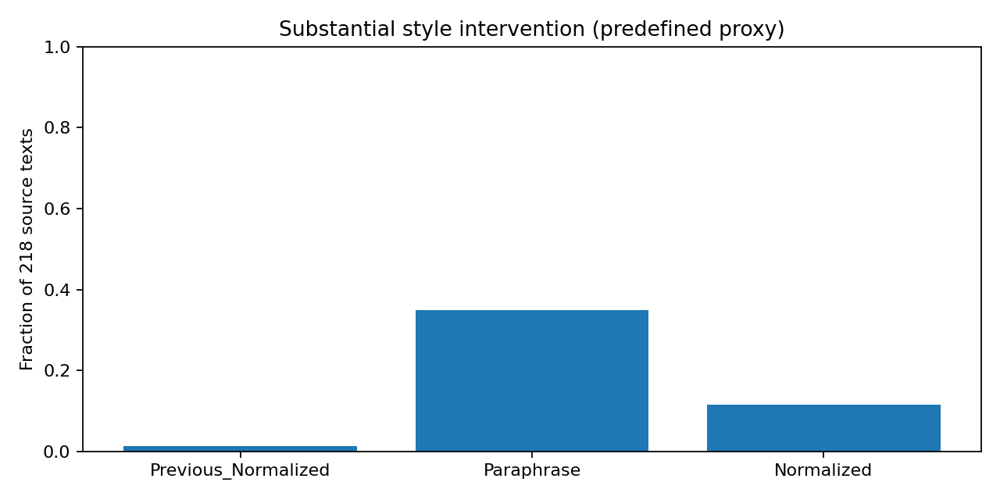
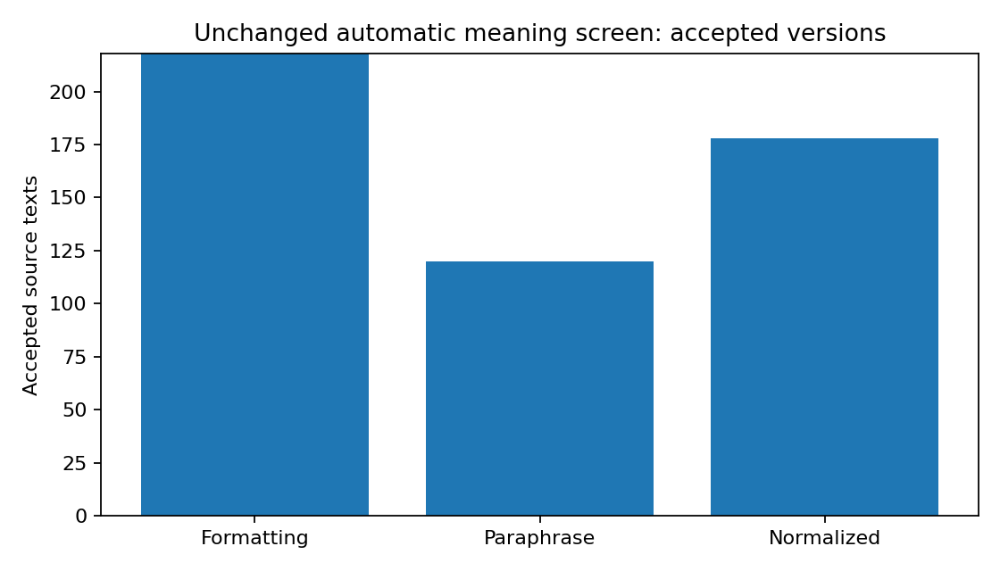
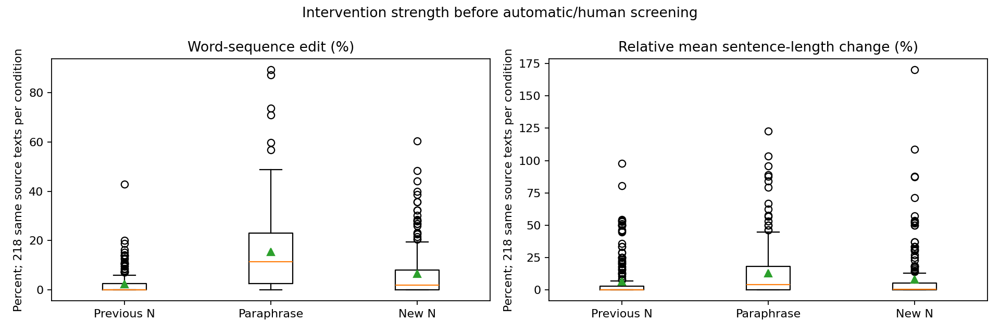

# ניסוי המשך: האם נרמול סגנון עוזר לזהות נרטיב אצל כותבים חדשים?

## תקציר

בדקנו כיצד לתקן את ההתערבות הסגנונית ואת האימות בניסוי הקודם. מצב נוכחי: **ממתין לאימות אנושי**.
נשמרו אותם 218 טקסטים, אותם 19 כותבים ואותה חלוקת train/validation/test.
נוצרו עד כה 218 נרמולים חדשים. אומתו אנושית 0 מתוך 218 טקסטים.
הפרפרזה נשארה קבועה כדי לבודד את שינוי ה־prompt של הנרמול. רמת הסינון לא הורדה.
נוצרה חבילת קריאה וסימון, ומדדי שינוי סגנון הוגדרו לפני תוצאות המסווג.
עברו אוטומטית את כל התנאים 114 טקסטים. מתוכם רק 5 עם שינוי סגנוני משמעותי;
חלוקתם היא {'val': 1, 'train': 3, 'test': 1}. לכן המדגם עם התערבות אמיתית עדיין קטן מדי להערכת generalization מבוססת.
**טרם הורצו מודלים חדשים.** ההרצה מותנית באימות אנושי אמיתי של התוויות ושל שני השכתובים. אין להציג את תוצאות הניסוי הקודם כתוצאות V2.

אין עדיין ראיה חדשה לשיפור ב־generalization או להסרת shortcut. תוצאות הסינון האוטומטי אינן אימות Narrative.
אין כרגע בסיס חדש לבניית LoRA/DoRA. אימון נוסף לבדו לא יפתור תוויות לא מאומתות או התערבות חלשה.


## 1. שאלת המחקר וההשערה

האם סגנון הכותב הוא shortcut מזיק, והאם שינוי סגנון תוך שימור תוכן משפר Macro-F1 על כותבים חדשים? השערה תיתמך רק אם נרמול עולה על Original ועל Paraphrase, זיהוי כותב יורד יחסית לשניהם, והתוכן מאומת והשיפור עקבי.

## 2. דאטה וספירות

| שלב | מספר |
| --- | --- |
| קטעים ייחודיים במאגר הקודם | 429 |
| טקסטים בניסוי הקפוא | 218 |
| כותבים | 19 |
| Train / Validation / Test לפני סינון | 105 / 43 / 70 |
| Normalized V2 שנוצרו | 218 |
| עברו אוטומטית את כל הזרועות | 114 |
| שינוי סגנוני משמעותי לפני סינון | 25 |
| שינוי משמעותי וגם עבר סינון Normalized | 13 |
| שינוי משמעותי וגם עבר את כל הזרועות | 5 |
| אימותים אנושיים מלאים | 0 |
| מדגם משותף קודם (להקשר בלבד) | 113 |

| split | לפני סינון | עברו כל התנאים אוטומטית | מהם שינוי משמעותי | כותבים אחרי סינון |
| --- | --- | --- | --- | --- |
| train | 105 | 54 | 3 | 9 |
| val | 43 | 21 | 1 | 4 |
| test | 70 | 39 | 1 | 6 |

ספירות המעבר כאן אוטומטיות בלבד, לפני הכרעה אנושית ובדיקת כפילויות שכתובים נוספת בשלב ההערכה.

כל רשומה היא קטע רציף בן כ־35–100 מילים ממאמר. גרסאות אינן דוגמאות עצמאיות. התוויות הקיימות הן הצעות AI ברמת הטקסט, בסולם confidence של 1–3; זה אינו ציון הסתברות מכויל. המחקר מוגבל ל־Left-wing ו־Right-wing.

## 3. הכותבים

| כותב ומקור ביוגרפי | טקסטים לפני סינון | split | הצעות תווית |
| --- | --- | --- | --- |
| [Ben Shapiro](https://www.creators.com/author/ben-shapiro) | 7 | test | {'Right-wing': 6, 'Left-wing': 1} |
| [David Harsanyi](https://www.creators.com/author/david-harsanyi) | 13 | train | {'Right-wing': 13} |
| [Stephen Moore](https://www.creators.com/author/stephen-moore) | 14 | test | {'Right-wing': 14} |
| [Dennis Prager](https://www.creators.com/author/dennis-prager) | 12 | test | {'Right-wing': 12} |
| [Star Parker](https://www.creators.com/author/star-parker) | 5 | val | {'Right-wing': 4, 'Left-wing': 1} |
| [Jim Hightower](https://www.creators.com/author/jim-hightower) | 21 | train | {'Left-wing': 21} |
| [Froma Harrop](https://www.creators.com/author/froma-harrop) | 10 | train | {'Right-wing': 4, 'Left-wing': 6} |
| [Debra J. Saunders](https://www.creators.com/author/debra-j-saunders) | 11 | val | {'Right-wing': 11} |
| [Joe Conason](https://www.creators.com/author/joe-conason) | 11 | test | {'Left-wing': 11} |
| [Susan Estrich](https://www.creators.com/author/susan-estrich) | 10 | val | {'Left-wing': 10} |
| [Marc Dion](https://www.creators.com/author/marc-dion) | 5 | train | {'Left-wing': 5} |
| [Jamie Stiehm](https://www.creators.com/author/jamie-stiehm) | 17 | train | {'Left-wing': 17} |
| [Veronique de Rugy](https://www.creators.com/author/veronique-de-rugy) | 6 | train | {'Right-wing': 6} |
| [Chuck Norris](https://www.creators.com/author/chuck-norris) | 14 | train | {'Right-wing': 14} |
| [Lawrence Kudlow](https://www.creators.com/author/lawrence-kudlow) | 13 | train | {'Right-wing': 13} |
| [Connie Schultz](https://www.creators.com/author/connie-schultz) | 6 | train | {'Left-wing': 6} |
| [Robert Scheer](https://www.creators.com/author/robert-scheer) | 14 | test | {'Left-wing': 14} |
| [Mona Charen](https://www.creators.com/author/mona-charen) | 17 | val | {'Left-wing': 11, 'Right-wing': 6} |
| [Jeff Robbins](https://www.creators.com/author/jeff-robbins-talent) | 12 | test | {'Left-wing': 11, 'Right-wing': 1} |

הייחוס מבוסס על byline יחיד ועמוד מחבר אצל המפרסם, כפי שנאספו בניסוי הקודם. אין בכך הוכחה להיעדר עורך או כותב צללים. לא נאספו מקורות זהות חדשים בשלב זה.

## 4. חלוקת הדאטה

קובצי analysis_cohort.csv, author_splits.csv ו־split_definitions.csv הועתקו ללא שינוי; hash מאמת זהות. כותבי test אינם ב־train/validation. אחרי אימות יוסרו זוגות בעלי דמיון חוצה split: cosine לפחות 0.97 או Jaccard shingles לפחות 0.7 באיזושהי גרסה. הסרה נעשית לשני הצדדים ולכל התנאים. אין להעביר כותב כדי לשפר ציון.

## 5. שלושת התנאים

Original: ללא שינוי. Paraphrase: גרסת הביקורת הקפואה מהניסוי הקודם, שביקשה לשמר סגנון ועמדה. Normalized V2: שכתוב חדש למבנה ישיר ואחיד; מותר לשנות סדר פסוקיות, פיסוק, פיצול משפטים וביטויים שאינם מעריכים. אין לשנות מסגור. Formatting נשמר לצורכי הסינון; במאמרים הקודמים היה זהה למקור.

## 6. מדוע הנרמול הקודם כמעט לא שינה

בדוח הקודם שיעור העתקה מדויקת ב־Normalized במדגם המשותף היה כ־50.4%, ובנרמול מילים כ־63.7%.
אלו קטעי מאמרים קצרים שכבר עברו עריכה, ולכן חלקם קרובים לסגנון היעד. בנוסף ה־prompt הקודם דרש ניסוח קרוב,
שמירת ביטויים מעריכים ושאלות רטוריות. הדוגמאות שלו המחישו שינויים קטנים מאוד.
אלה הסברים סבירים מהטקסטים ומההוראות; לא נערך ablation המפריד את תרומתם. אין הוכחה איזה מהם גרם להעתקה.

## 7. ה־prompt החדש ומודל היצירה

Qwen2.5-3B-Instruct, Q4_K_M, revision 7dabda4d13d513e3e842b20f0d435c732f172cbe; llama.cpp מקומי, b11887. משקלים קפואים, seed 20261026, temperature=0, max_tokens=320 (בקודם 240). אין תווית אמת או שם כותב במטא־דאטה הנשלח; שמות שעולים בטקסט עצמו נשארים. שינוי התקציב מתועד ולכן שינוי התוצאות אינו מזוהה כשינוי prompt בלבד. אין ניסיונות חוזרים או בחירה לפי תחזית.

ה־prompts המלאים לשתי הזרועות: rewrite_prompts.json. הוראת הנרמול בפועל:

```text
Rewrite the entire input faithfully. Output only the rewritten English text.
Preserve EVERY assertion, allegation, evaluation, political stance and framing.
Preserve actors, actions, causal roles, entities, dates, numbers, negation and its
scope, certainty, tense, attribution, first-person referents and implied judgments.
Keep names, quoted spans, numbers, modal/uncertainty words and politically evaluative
words verbatim. Never resolve an ambiguous pronoun or invent a motive. Never add,
omit, weaken or strengthen a claim. A rhetorical question must remain a question
if making it declarative changes its presupposition. Preserve the language.
Do not add a title, explanation or commentary.
TASK: actively recast the prose into a single house style: plain, moderately
formal editorial English, complete sentences, standard punctuation, mostly short
subject-verb-object clauses. This is a syntactic rewrite, NOT a light copy edit.
Change clause order within sentences and the placement of attribution when safe.
Split a long sentence or combine very short sentences when all logical relations
remain explicit. Replace non-evaluative idioms with literal equivalents and remove
decorative fillers. Prefer direct grammatical constructions to ornate ones.
Do not copy the original sentence structure throughout. If already plain, recast
the opening construction and clause arrangement rather than returning the input.
Retain evaluative expressions, insults, uncertainty and rhetorical implication even
when they sound informal. Changing these would change framing. Aim for similar
length (80-120%); preserving all meaning takes priority over word count or edits.
Before answering silently compare every claim and attribution to the input.
```

## 8. כמה הסגנון השתנה

| תנאי | N | העתקים מדויקים | שינוי משמעותי לפי כלל תפעולי | ממוצע עריכת מילים |
| --- | --- | --- | --- | --- |
| Previous_Normalized | 218 | 99 | 3 | 2.3% |
| Paraphrase | 218 | 30 | 76 | 15.5% |
| Normalized | 218 | 64 | 25 | 6.4% |

word_edit_fraction הוא 1 פחות יחס SequenceMatcher על רצף מילים; הוא מדד אי־דמיון סימטרי, ולא אחוז מילים שהוחלפו מילולית. נשמרים בנפרד אחוז מילים מקוריות שהוחלפו/נמחקו ומילים שנוספו. נשמרים שינוי אורך, מספר משפטים, ממוצע מילים במשפט, מרחק פיסוק ו־66 מאפייני הסגנון הקיימים. סטנדרטיזציה רק על Original ב־train. מדד פורמליות הוא proxy מצומצם של כיווצים ומילות דיבור, ולא כלי פורמליות מתוקף. שינוי מבנה הוא proxy לפי אורכי משפטים, ללא parser תחבירי.

כלל שנקבע מראש: עריכת מילים ≥15% וגם שינוי ממוצע אורך משפט ≥15%, או מרחק פיסוק ≥1 ל־100 מילים, או שינוי כיווצים ≥1 ל־100 מילים. מתחת ל־5% עריכת מילים מסומן minimal; יתר המקרים שאינם substantial מסומנים intermediate. זה אינו מוכיח סגנון אחיד או שמירת משמעות.

## 9. סינון ושיעורי פסילה

MPNet cosine ≥0.85; DeBERTa NLI בשני הכיוונים ≥0.6; שמירת ישויות, מספרים, שלילה, ודאות, ייחוס, anchors של מסגור, זמן עתיד וציטוטים; יחס אורך 0.6–1.65; אין קטיעת קלט או פלט. אלה בדיוק הבדיקות הקודמות. אין הקלה כדי להגדיל N.

| תנאי | נבדקו | עברו | נפסלו |
| --- | --- | --- | --- |
| Formatting | 218 | 218 | 0 |
| Paraphrase | 218 | 120 | 98 |
| Normalized | 218 | 178 | 40 |

| תנאי | סיבה אוטומטית | מספר |
| --- | --- | --- |
| Paraphrase | bidirectional_nli | 51 |
| Paraphrase | quotations | 28 |
| Paraphrase | entities | 27 |
| Normalized | bidirectional_nli | 18 |
| Paraphrase | certainty | 14 |
| Paraphrase | future_tense | 12 |
| Paraphrase | attribution | 11 |
| Paraphrase | negation | 11 |
| Normalized | quotations | 10 |
| Normalized | certainty | 7 |
| Paraphrase | similarity | 6 |
| Normalized | entities | 5 |
| Normalized | future_tense | 4 |
| Normalized | attribution | 4 |
| Normalized | negation | 4 |
| Paraphrase | framing_anchors | 3 |
| Paraphrase | numbers | 3 |
| Normalized | framing_anchors | 1 |

סיבות יכולות לחפוף. כשל אוטומטי הוא דגל סיכון, לא הוכחה לשינוי משמעות. מעבר אוטומטי אינו הוכחה לשימור stance/framing.

## 10. הרחבת המדגם

נרמול חדש מוחל על כל 218 הטקסטים. מאחר שהפרפרזה מוחזקת קבועה ועברה קודם רק ב־120, התקרה לשלב זה היא 120 טקסטים משותפים לעומת 113 קודם. לכן לא ניתן לצפות להגדלה גדולה משינוי הנרמול לבדו. לא נאספים טקסטים/כותבים חדשים ולא משנים split. הרחבת בסיס הדאטה או שיפור שתי הזרועות דורשים גרסה נפרדת, עם תקציב שווה לשתי זרועות ה־LLM.

## 11. אימות אנושי פשוט

פתחו HUMAN_REVIEW_HE.md לקריאה או human_review.csv לסימון. בכל שורה מופיעים המקור, הצעת תווית, confidence, evidence ושני השכתובים. סמנו yes/no/unclear בכל שדה; claim_added/claim_omitted צריכים להיות no כדי לעבור. הזינו שם/מזהה סוקר אמיתי, תאריך ISO ותווית אנושית. Unclear הוא מותר ומוסר מהניסוי. השארת שדה ריק פירושה לא נבדק. אין למלא שם סוקר או yes באופן אוטומטי. שתי הערכות אנושיות בלתי תלויות לא בוצעו כאן.

לתווית ללא הצעת AI: human_labels_blind.csv, עם מפתח נפרד. הקובץ המשולב הוא אימות בסיוע הצעה, לא הערכה עיוורת. אפשר לשמור שתי גרסאות לסוקרים, אך אין קוד המניח agreement אנושי שלא נמדד. הסקר האנושי יכול לפסול מעבר אוטומטי; אינו עוקף את הגדרות הסינון בשלב הזה.

## 12. אימון, מדדים ו־seeds

לאחר שכל הרשומות סומנו: MiniLM הקפוא הקיים בפרויקט וראש חדש 384→128→7, ReLU, dropout 0.3; Adam, lr 0.001, batch 16, 20 epochs. חמישה seeds: 7,42,123,2026,31415. אותה ארכיטקטורה, תקציב ומקורות בכל זרוע. checkpoint נבחר לפי validation בלבד. Macro-F1 העיקרי הוא לשתי הקטגוריות הפעילות; גם F1 לשבע יציאות נשמר. נשמרים Accuracy, Recall לכל קטגוריה, NLL ו־Brier וכל הסתברויות התחזית.

נבדקות כל 9 צירופי train/test. הניתוח העיקרי משווה את האלכסון N→N מול P→P, ובנפרד N→Original לבדיקת העברה לטקסטים מקוריים. חמש חזרות אינן חמישה מדגמי test עצמאיים. בדיקות זיהוי כותב מאומנות מחדש לכל תנאי, בנפרד ל־embeddings ולמאפיינים מפורשים, עם scaler על train בלבד ובדיקת חפיפה משלהן. אלו probes על אותם כותבים בשתי המחיצות; ניסוי הנרטיב הוא author-disjoint.

## 13. ניתוח שינוי משמעותי

כעת נשארו במדגם המשותף רק 5 טקסטים עם שינוי משמעותי, בחלוקה {'val': 1, 'train': 3, 'test': 1}. אין בכך בסיס להערכת subset, אפילו לפני אפשרות לפסילות אנושיות נוספות. הקובץ substantial_automatic_subset.csv מאפשר לבדוק בדיוק אילו טקסטים נשארו.

אותו כלל שנקבע מראש יוצר subset לפי Normalized בלבד; בכל השוואה נשמרות בדיוק אותן רשומות ל־Original ול־Paraphrase. אלו טקסטים שנבחרו לפי תגובה להתערבות, ולכן אינם מדגם אקראי ואינם אומדן השפעה סיבתי. אימון subset ירוץ רק אם נשארו ≥3 דוגמאות ו־≥2 כותבים מכל קטגוריה בכל split. אם לא, תירשם אי־יכולת להעריך ולא ייוצר ציון מטעה.

## 14. תוצאות

**טרם הורצו מודלים חדשים.** ההרצה מותנית באימות אנושי אמיתי של התוויות ושל שני השכתובים. אין להציג את תוצאות הניסוי הקודם כתוצאות V2.

תוצאות העבר, להקשר בלבד: Original 0.532; Paraphrase 0.590; Normalized 0.544. הן ממדגם אחר ואינן baseline ישיר למדגם V2 אם הסינון משתנה.

## 15. גרפים







## 16. דוגמאות אמיתיות

שלוש הרשומות הראשונות בסדר הקלט, ובנוסף שני מקרים ראשונים מ־train שמסומנים כשינוי משמעותי (אם קיימים). הבחירה מבוססת על עוצמת שינוי צורני, לא על תוצאת מסווג. דוגמאות נבחרות אינן שיעור הצלחה, ואינן בהכרח עברו סינון משמעות.

### creators:423645
[מקור ותאריך: 2026-09-14](https://www.creators.com/read/ben-shapiro/09/26/the-immigration-politics-of-a-felons-pardon-31fa1)

**Original**
How far will New York Gov. Kathy Hochul go to keep immigrant criminals in this country? So far, she'll even pardon a man convicted of an aggravated felony, if that's what it takes to prevent the United States Supreme Court from setting a restrictionist precedent.

**Paraphrase**
How far will New York Gov. Kathy Hochul go to keep immigrant criminals in this country? So far, she's even pardoned a man convicted of an aggravated felony, if that's what it takes to prevent the United States Supreme Court from setting a restrictionist precedent.

**Normalized V2**
How far will New York Gov. Kathy Hochul go to keep immigrant criminals in this country? So far, she'll even pardon a man convicted of an aggravated felony, if that's what it takes to prevent the United States Supreme Court from setting a restrictionist precedent.

### creators:222877
[מקור ותאריך: 2018-02-17](https://www.creators.com/read/lawrence-kudlow/02/18/trump-needs-a-return-to-king-dollar)

**Original**
The Trump administration and the Republicans in Congress have passed one of the best pro-growth tax bills ever. The Tax Cuts and Jobs Act ranks in the all-time hall of fame along with former President Reagan's 1981 and 1986 tax acts, and former President Kennedy's posthumous tax cuts in 1964. The announcements by Apple, FedEx, AT&T, Fiat Chrysler and over 300 companies with multibillion dollar investments in the United States are early lead indicators of good things to come from the tax-rate cuts.

**Paraphrase**
The Trump administration and Republicans in Congress have passed one of the best pro-growth tax bills ever, I suppose. The Tax Cuts and Jobs Act ranks in the all-time hall of fame alongside former President Reagan's 1981 and 1986 tax acts, and former President Kennedy's posthumous tax cuts in 1964. Announcements by Apple, FedEx, AT&T, Fiat Chrysler, and over 300 companies with multibillion-dollar investments in the United States are early lead indicators of good things to come from the tax-rate cuts.

**Normalized V2**
The Trump administration and Republicans in Congress have passed one of the best pro-growth tax bills ever. The Tax Cuts and Jobs Act ranks alongside former President Reagan's 1981 and 1986 tax acts, as well as former President Kennedy's posthumous tax cuts of 1964, in the all-time hall of fame. Early lead indicators of good things to come include announcements by Apple, FedEx, AT&T, Fiat Chrysler, and over 300 companies with multibillion-dollar investments in the United States.

### creators:421269
[מקור ותאריך: 2026-08-12](https://www.creators.com/read/jim-hightower/08/26/voters-rebel-against-effort-by-missouri-gop-to-kill-voter-rights)

**Original**
They're so disgusted that a top legislative priority of Republican leaders in the White House, Congress and state legislatures is to rig election rules, literally to rule out issues and voters they don't like. For example, Republicans in Missouri (the "Show Me" State) showed us what they're made of by attempting to kill the people's right to amend their state's constitution. Missouri and 25 other states have long provided a citizen-led initiative process so the people can propose and pass their own laws, rather than always depending on politicians to "do what's right." Yes — it's direct democracy!

**Paraphrase**
They're so disgusted that a top legislative priority of Republican leaders in the White House, Congress, and state legislatures is to rig election rules, literally to rule out issues and voters they don't like. For example, in Missouri (the "Show Me" State), Republicans attempted to kill the people's right to amend their state's constitution. Missouri and 25 other states have long provided a citizen-led initiative process, allowing the people to propose and pass their own laws, rather than always depending on politicians to "do what's right." Yes — it's direct democracy!

**Normalized V2**
They're so disgusted that a top legislative priority of Republican leaders in the White House, Congress, and state legislatures is to rig election rules, literally to rule out issues and voters they don't like. For example, Republicans in Missouri (the "Show Me" State) attempted to kill the people's right to amend their state's constitution. Missouri and 25 other states have long provided a citizen-led initiative process, allowing the people to propose and pass their own laws, rather than always depending on politicians to "do what's right." Yes — it's direct democracy!

### creators:222877
[מקור ותאריך: 2018-02-17](https://www.creators.com/read/lawrence-kudlow/02/18/trump-needs-a-return-to-king-dollar)

**Original**
The Trump administration and the Republicans in Congress have passed one of the best pro-growth tax bills ever. The Tax Cuts and Jobs Act ranks in the all-time hall of fame along with former President Reagan's 1981 and 1986 tax acts, and former President Kennedy's posthumous tax cuts in 1964. The announcements by Apple, FedEx, AT&T, Fiat Chrysler and over 300 companies with multibillion dollar investments in the United States are early lead indicators of good things to come from the tax-rate cuts.

**Paraphrase**
The Trump administration and Republicans in Congress have passed one of the best pro-growth tax bills ever, I suppose. The Tax Cuts and Jobs Act ranks in the all-time hall of fame alongside former President Reagan's 1981 and 1986 tax acts, and former President Kennedy's posthumous tax cuts in 1964. Announcements by Apple, FedEx, AT&T, Fiat Chrysler, and over 300 companies with multibillion-dollar investments in the United States are early lead indicators of good things to come from the tax-rate cuts.

**Normalized V2**
The Trump administration and Republicans in Congress have passed one of the best pro-growth tax bills ever. The Tax Cuts and Jobs Act ranks alongside former President Reagan's 1981 and 1986 tax acts, as well as former President Kennedy's posthumous tax cuts of 1964, in the all-time hall of fame. Early lead indicators of good things to come include announcements by Apple, FedEx, AT&T, Fiat Chrysler, and over 300 companies with multibillion-dollar investments in the United States.

### creators:417181
[מקור ותאריך: 2026-06-05](https://www.creators.com/read/david-harsanyi/06/26/the-splcs-real-scam)

**Original**
It turns out that the most generous funder of white supremacist groups in the United States was likely the Southern Poverty Law Center. At least that's what the Department of Justice's superseding indictment against the SPLC alleges. The organization secretly paid informants to engage in the active promotion and funding of racist groups while denouncing and "fighting" the very same groups in public. The SPLC purportedly created fictitious entities to hide funding from their donors.

**Paraphrase**
It seems the Southern Poverty Law Center, a supposed champion of civil rights, might have secretly funded white supremacist groups. According to a superseding indictment by the Department of Justice, the SPLC allegedly paid informants to promote and fund racist groups while publicly denouncing them. The organization also created fake entities to conceal its funding from donors.

**Normalized V2**
It turns out that the Southern Poverty Law Center, the most generous funder of white supremacist groups in the United States, was allegedly secretly paying informants to promote and fund these groups while publicly denouncing them. The SPLC allegedly created fictitious entities to hide its funding from donors. This is what the Department of Justice's superseding indictment alleges.


## 17. מה ניתן להסיק

אפשר למדוד עד כמה ההתערבות החדשה משנה מדדים צורניים ואילו זוגות עברו את אותו מסנן. אם השינוי משמעותי ונשמרו meaning/stance/framing באימות אנושי, אפשר יהיה לבדוק את ההשערה על התערבות אמיתית יותר. אין להכריז שיפור לפני הרצה על תוויות מאומתות.

## 18. מה לא ניתן להסיק ומגבלות

המסננים אינם מוכיחים שימור נרטיב. ירידת probe אינה מוכיחה הסרת Author Style בלבד: גם תוכן קשור לכותב. גידול Macro-F1 לבדו אינו מוכיח מנגנון סגנוני. מדגם קטן, שני נרטיבים, מקור חדשותי אחד, קטעים קצרים, attribution שאינו הוכחת מחבר יחיד בפועל, תוויות AI ואימות בסיוע הצעה מגבילים הכללה. גם תוצאת אפס לא תפריך את ההשערה. אין ניסוי counterfactual נוסף ב־V2 ואין לייחס לו תוצאות כאלה מהעבר.

## 19. Verdict

האם השתנה Style? ראו מדדי V2; זהו אומדן צורני שדורש גם בדיקה אנושית. האם נשמר Narrative? טרם אומת אנושית. האם זיהוי הכותב ירד? אין תוצאת V2 לפני הרצה מאומתת. האם השתפר Macro-F1 והאם N טוב מ־P? עדיין לא ניתן לקבוע. האם לבנות LoRA? אין כרגע הצדקה חדשה. אין תמיכה מחקרית חדשה בהשערה עד השלמת האימות וההרצה.

## 20. המשך מומלץ ושחזור

ראשית השלימו סימון אנושי. לאחריו הריצו evaluate ו־report לפי README. אם המדגם קטן או ההתערבות לא השתנתה מספיק, הרחיבו דאטה או בצעו השוואת generator/prompt בתקציב זהה בשתי הזרועות, בגרסה חדשה. אל תעברו ל־LoRA כדי לפצות על תוויות/התערבות לא מאומתות. audit_trail.jsonl שומר שלב, זמן UTC, hash קלט/פלט, prompt/model, seed וספים; קובצי JSON משלימים ספירות וגרסאות.

## עדכון 2026-11-01 — הכנת חבילת 30 דוגמאות לבדיקה חיצונית

הוכנה [חבילת בדיקה אחת לקריאה ולהעברה](external_review_30_20261101/REVIEW_30_TRAIN_ONLY_HE.md), וכן CSV מקביל באותה תיקייה. נבחרו 30 טקסטים מ־9 כותבי האימון בלבד: 10 עם שינוי משמעותי לפי proxy, 10 עם שינוי מזערי שעברו סינון, ו־10 שנפסלו אוטומטית. הבחירה מתועדת ב־selection_audit.json וניתן לשחזר אותה באמצעות prepare_review.py. זהו מדגם אבחוני מכוון, לא מדגם להערכת שיעורי הצלחה.

לכל רשומה נשמרו המקור, שני השכתובים, הצעת הנרטיב, confidence, כל הבדיקות האוטומטיות, סיבות המעבר/הפסילה ומדדי הסגנון. ששת השדות human_narrative_label, narrative_label_correct, paraphrase_meaning_preserved, normalized_meaning_preserved, style_change_valid, human_notes הושארו ריקים. לא בוצעו שיפוט חדש, קריאה למודל, שינוי תוויות, שינוי test/validation, הקלת סינון או אימון מחדש.

**בדיקת LLM חיצונית התקבלה ותועדה בנפרד להלן; אימות אנושי אמיתי עדיין ממתין.** ההערכה החיצונית מאפשרת דיון אבחוני, אך לא שינתה שכתובים, סינון או תוויות ולא פתחה את שער האימון. בדיקה ב־ChatGPT היא בדיקת LLM חיצונית, ואינה תחליף לסוקר אנושי או ל־human gold; יש לתעד אותה בהתאם. אין לשייך בדיקה כזו לאימות האנושי שבשער האימון.

## External LLM Evaluation — עדכון 2026-11-01

**התקבלה הערכת ChatGPT חיצונית ל־30 דוגמאות מכותבי האימון בלבד.** הדירוגים יובאו כפי שנמסרו, ללא הכרעת תוכן חדשה. קובץ המקור נשמר בהעתק זהה בבתים. זו אינה Human Review, אינה human annotation ואינה human gold.

### הפרדה בין מקורות המידע

| מקור | מה התקבל | סטטוס |
|---|---|---|
| בדיקות אוטומטיות קיימות | ציוני NLI/דמיון, ישויות, guards ומדדי סגנון; 114 טקסטים משותפים עברו את המסננים | נשארו כפי שהיו; מעבר אינו הוכחת שימור |
| External LLM Review | דירוגים והערות של ChatGPT ל־30 דוגמאות | נשמרו בתיקייה נפרדת, ללא העברה לשדות אנושיים |
| אימות אנושי אמיתי | הכרעת סוקר/ת אדם בתוויות ובשכתובים | עדיין ממתין; הייבוא לא השלים אף רשומה אנושית |

### תוצאות ההערכה החיצונית בלבד

| דירוג LLM | Yes | No | Borderline |
|---|---|---|
| אישור הצעת הנרטיב | 27 | 3 | 0 |
| Paraphrase — שימור משמעות | 23 | 4 | 3 |
| Normalized — שימור משמעות | 27 | 3 | 0 |
| Paraphrase — שינוי סגנון | 14 | 14 | 2 |
| Normalized — שינוי סגנון | 9 | 20 | 1 |

ה־LLM אישר 27 הצעות נרטיב וסימן 3 טקסטים כ־Unclear. תוויות הניסוי לא הוחלפו בעקבות זאת.
לפי הדירוגים החיצוניים, 19 נרמולים שמרו משמעות אך לא שינו סגנון באופן ממשי; 7 קיבלו Yes בשני הסעיפים. שני נרמולים קיבלו Yes לשינוי סגנון אך No לשימור משמעות.

### פערים מול הסינון ודוגמאות כפי שתוארו בידי ה־LLM

- creators:421024: ה־LLM העריך ששני השכתובים שומרים משמעות, למרות פסילת Paraphrase בבדיקת ציטוטים.
- creators:423545: ה־LLM תיאר את פסילת NLI של Paraphrase כמחמירה למרות שימור התוכן, וציין ניסוח דקדוקי מסורבל.
- creators:418904: ה־LLM הבחין בין שימור משמעות כללית לבין החלפת מילה בתוך ציטוט — פגיעה בנאמנות לציטוט שעדיין אסורה לפי הפרוטוקול.
- creators:417181: לפי ה־LLM, שני השכתובים משנים certainty/attribution והפרפרזה מוסיפה תיאור שלא היה במקור.
- creators:120669: ה־LLM סימן בנרמול החלפה שגויה של נושא נאומי חג ההודיה מאובמה לוושינגטון.
- creators:459e183c1d0d: ה־LLM ציין השמטת ההסתייגות allegedly one-time; בפרפרזה ציין גם שינוי במעמד Berkeley ובהצגת הקצאת 90% מההכנסות.
- creators:218236 ו־creators:418827: הפרפרזות סומנו Borderline בשל שינוי דק בייחוס/עמדה או הפיכת ניסוח רטורי לטענה קונקרטית.

הפערים אינם מתירים לבטל פסילות: חלקם משקפים הבדל בין משמעות כללית לבין דרישת השימור המחמירה. לא שונו ספים או החלטות קבלה.

### מסקנה ראשונית ומה עדיין לא ניתן להסיק

**לפי הבדיקה החיצונית, הבעיה אינה רק בסינון:** במקרים רבים Normalized שומר על המשמעות אבל כמעט לא משנה סגנון; כאשר השינוי הסגנוני משמעותי יותר יש לעיתים פגיעה בפרטים סמנטיים. זו אינדיקציה אבחונית מתוך הדירוגים שנמסרו, לא אמת אנושית מאומתת ולא אומדן על כל המאגר.
המדגם נבחר במכוון בשלוש קבוצות מכותבי האימון. ה־LLM ראה שמות כותבים, הצעות נרטיב וציוני סינון; אין כאן בדיקה עיוורת. גרסת המודל, prompt ההערכה ותאריך ביצוע ההערכה לא סופקו. אין להסיק agreement בין בני אדם או עצמאות מהתיוגים הקודמים.
אין תוצאת Macro-F1 חדשה, אין Author Identification חדש ואין הוכחה להסרת shortcut. לא הורץ אימון מחדש ולא שונו חלוקת הנתונים, test, תוויות אנושיות או קוד אימון. אימות אנושי אמיתי עדיין נדרש לפני מעבר בשער האימון; ה־External LLM Review אינו פותח אותו. אין כרגע הצדקה חדשה ל־LoRA/DoRA.

[הסיכום המלא וכל 30 הדירוגים](external_llm_review_20261101/EXTERNAL_LLM_REVIEW_SUMMARY_HE.md) · [קובץ המקור ללא שינוי](external_llm_review_20261101/LLM_EXTERNAL_REVIEW_30_20261101.csv) · [ספירות ניתנות לשחזור](external_llm_review_20261101/summary.json)

## Train-only prompt revision — 2026-11-01

ה־prompt החדש נוסה על 30 דוגמאות מ־train בלבד, מתוך המדגם האבחוני שנבחר קודם. כל שכתוב חדש נוצר רק מן ה־Original; ה־Paraphrase וה־Normalized הקודמים לא שימשו קלט לשכתוב. המודל המקומי והגדרות הפענוח נשמרו, וכך גם בדיקות השימור, הספים וכלל שינוי הסגנון הקיימים. זהו מדגם פיתוח מכוון, לא הערכת הצלחה מייצגת או ראיה להכללה לכותבים שלא נראו.

| מדד על אותן 30 דוגמאות | Old Normalized | New Normalized |
|---|---:|---:|
| מעבר כל בדיקות השימור האוטומטיות | 23/30 | 6/30 |
| שינוי סגנוני משמעותי לפי ה־proxy הקיים | 10/30 | 24/30 |
| הצלחה בשניהם יחד | 7/30 | 6/30 |
| exact copies של המקור | 7 | 0 |

**ה־prompt החדש אגרסיבי יותר בשינוי style, אבל מייצר הרבה יותר פסילות בבדיקות השימור.** פסילה אוטומטית היא signal לסיכון בלבד, ולא הוכחה ל־semantic drift; מעבר אוטומטי גם אינו אימות של שימור משמעות. שינוי משמעותי לפי proxy אינו אימות חיצוני של שינוי style אמיתי או של הסרת סימני כותב. אין להסיק מהסבב שיפור ב־Macro-F1, ב־Author Identification או בהסרת shortcut.

דוגמאות מרכזיות:

- `creators:120669` — דגל ה־NLI הקודם נפתר: השכתוב החדש עובר בסינון. זו תוצאה אוטומטית, לא הכרעה חיצונית שהמשמעות נשמרה במלואה.
- `creators:419062`, `creators:423315`, `creators:224770` — שינוי ה־style הפך למשמעותי לפי הכלל הקיים תוך מעבר בכל בדיקות השימור.
- `creators:212505` — פסילה בגלל numbers בעקבות `10` → `ten` ב־“next 10 weeks”; כנראה false positive טכני של ייצוג המספר. הדבר אינו מאמת אוטומטית את יתר השכתוב.
- `creators:298495` — דגלי negation ו־attribution; בין היתר “strangers” הוחלף ב־“anonymous sources”. נדרשת בדיקה חיצונית.
- `creators:114783` — דגלי numbers, negation, attribution ו־quotations; הציטוט המקורי לא נשמר כלשונו. נדרשת בדיקה חיצונית של משמעות, ייחוס וציטוטים.

ה־Old Normalized וה־New Normalized נשמרו זה לצד זה בקבצים נפרדים מן התוצרים הקודמים: [טבלת כל 30 ההשוואות](train_prompt_revision_30_20261101/COMPARISON_30_HE.md), [CSV עם הטקסטים והבדיקות](train_prompt_revision_30_20261101/comparison_30.csv). [הדוח המפורט](train_prompt_revision_30_20261101/REPORT_HE.md), [ה־prompt המדויק](train_prompt_revision_30_20261101/prompt.txt), [ספירות ניתנות לשחזור](train_prompt_revision_30_20261101/summary.json) ו[הוראות השחזור](train_prompt_revision_30_20261101/README.md) מתעדים את הסבב. תוצרי הבדיקה החיצונית הקודמת מתייחסים לגרסאות הישנות בלבד.

לא שונו test, validation, החלוקה, התוויות, הספים או שדות human review. לא בוצע אימון מחדש. **עוצרים כאן:** השלב הבא הוא External LLM Review חדש של כל 30 ה־New Normalized, שיבחין בין semantic drift אמיתי, false positives של ה־guards ושינוי style אמיתי. אין לכוונן שוב את ה־prompt או הסינון לפני הבדיקה הזו. בדיקת LLM אינה אימות אנושי ואינה ממלאת את שדות human review.

## New Normalized — External LLM Review 2026-11-01

יובא קובץ הבדיקה החיצונית של כל 30 ה־New Normalized, בהתאמת ID מלאה למדגם train בלבד. ההכרעות להלן הן דירוגי LLM שסופקו, לא שיפוט חדש של סוכן הייבוא ולא אימות אנושי. גרסת המודל, prompt ההערכה ומועד ההערכה המדויק לא סופקו. הקובץ אינו מכיל hash או טקסט שנסקר; שיוך הגרסאות נשען על ה־IDs והקשר המסירה. אין לטעון לבדיקה עיוורת או לעצמאות בין הסבבים.

**שם הבדיקה: External LLM Review — New Normalized.** היא נשמרת בנפרד מ־Human Validation ומבדיקת ה־Old Normalized הקודמת.

| שדה חיצוני | Yes | Borderline | No |
| --- | --- | --- | --- |
| meaning_preserved | 10 | 15 | 5 |
| stance_preserved | 29 | 1 | 0 |
| attribution_preserved | 29 | 0 | 1 |
| certainty_preserved | 28 | 2 | 0 |
| style_change_valid | 30 | 0 | 0 |
| semantic_drift | 20 | 0 | 10 |

Meaning Preserved: **10/30 Yes, ‏15/30 Borderline, ‏5/30 No**. שינוי style אמיתי לפי ה־External LLM Review: **30/30**; זהו דירוג הבודק החיצוני ולא אימות אנושי.

### סיווג פערים ביחס ל־LLM

"Positive" פירושו איתות לסיכון בשימור משמעות. True/False מתארים התאמה ל־LLM בלבד, לא אמת מחקרית מאומתת. פסילה אוטומטית ו־semantic_drift=Yes מסווגת True Positive; פסילה עם meaning=Yes ו־drift=No היא False Positive; מעבר עם אותו אישור הוא True Negative; מעבר עם drift=Yes או Borderline משמעותי הוא False Negative. כל 15 מקרי ה־Borderline בקובץ מסומנים גם semantic_drift=Yes במקור, ולכן הסיווג נשען על דגל מפורש, בלי להמיר meaning=Borderline ל־No. שדה המשמעות המקורי נשמר, וכן קובץ Borderline נפרד ופירוט בכל קטגוריה.

| סיווג ביחס ל־LLM | סה״כ | Meaning Yes | Meaning Borderline | Meaning No |
| --- | --- | --- | --- | --- |
| True Positive | 19 | 0 | 14 | 5 |
| False Positive | 5 | 5 | 0 | 0 |
| True Negative | 5 | 5 | 0 | 0 |
| False Negative | 1 | 0 | 1 | 0 |

פסילות שנראו מוצדקות לפי ה־LLM (True Positive): creators:422329, creators:417181, creators:422331, creators:216128, creators:421279, creators:295188, creators:422146, creators:421853, creators:114783, creators:8b0d99b23d03, creators:97c9d6b9ac1b, creators:423545, creators:298495, creators:418904, creators:2e34435c6ccf, creators:416436, creators:116358, creators:218236, creators:418827.

פסילות שנראו False Positives לפי ה־LLM: creators:0105f26ef9f1, creators:120177, creators:212505, creators:418620, creators:459e183c1d0d.

עברו אוטומטית אך קיבלו Borderline/No: creators:423315 — במקרה זה Borderline, ואין מקרה שעבר וקיבל No.

דוגמאות הכשל המרכזיות לפי הבודק: `417181` — semantic drift והתחזקות certainty, לצד שינוי ייחוס; `8b0d99b23d03` — שינוי הציטוט המיוחס ל־F. Scott Fitzgerald ושינוי מטאפורת “two countries”; `423545` — החלשת stance/המסגור באמצעות הסרת “right-wing hack” והחלשת המטאפורה (למרות שדה stance_preserved=Yes, שנשמר כמות שהוא); `298495` — שינוי עובדתי מ־strangers ל־anonymous sources; `418904` — שינוי ציטוט ישיר. אלו פירושים לתוצאות ה־LLM שסופקו, ולא הכרעות אנושיות חדשות או אימות פרטני של כל guard.

שימור מחמיר לצורך סיכום בלבד (meaning, stance, attribution, certainty כולם Yes וגם semantic_drift=No): **10/30**; שימור מחמיר ושינוי style=Yes יחד: **10/30**. זהו חיתוך תיאורי של שדות חיצוניים, לא שינוי סף קבלה או מסנן.

מבין הפסילות האוטומטיות, 5 דורגו כשימור מחמיר — מועמדים ל־false positives ביחס לבודק החיצוני, לא הוכחת תקינות. מבין המעברים האוטומטיים, 1 קיבלו meaning שאינו Yes. אין להמיר אי־הסכמה עם LLM ל־false positive/negative מאומת. Borderline נשמר בנפרד ואינו נספר כהצלחה; semantic_drift=Yes הוא קביעת ה־LLM בלבד.

`creators:120669`: הבודק מציין שהטעות Obama/Washington הקודמת תוקנה. `212505`: הבודק רואה ב־10→ten שינוי עיצוב בלבד ומאשר שימור. `419062` ו־`224770` מאושרים לשימור ולסגנון; לעומתם `423315`, שעבר בסינון, דורג Borderline בגלל riots→protests ו־going to lose→destined to lose. `421951` עבר אוטומטית ואושר חיצונית; זו עדיין אינה אמת אנושית. `298495` דורג No במשמעות בגלל strangers→anonymous sources, אף ששדה attribution דורג Yes; ההבדל בין השדות נשמר. `114783` דורג Borderline עם פגיעה בנאמנות לציטוט. אין להסיק מכך שדגלי negation/attribution שלו אומתו פרטנית.

ה־LLM דירג שינוי style כ־Yes בכל 30 המקרים. לעומת זאת ה־proxy האוטומטי סימן 24/30. בבדיקה החיצונית הקודמת של Old Normalized היו meaning=Yes ב־27/30 ו־style=Yes ב־9/30; אין זו השוואה מבוקרת בין מעריכים, ואין לערבב ספירות חיצוניות עם 23→6 ו־10→24 האוטומטיות. התמונה התיאורית היא שינוי סגנוני רחב יותר לצד יותר הסתייגויות משימור משמעות.

לא שונו prompt, guards, ספים, טקסטים, תוויות, split, test או שדות human review; לא הורצו מודל שופט, שכתוב נוסף או אימון. הבדיקה אינה פותחת את שער האימות האנושי לאימון. עוצרים לדיון בתוצאות לפני כל ניסוי או כוונון נוסף.

**ה־prompt החדש מצליח לייצר שינוי סגנוני משמעותי, אבל מגדיל את הסיכון ל־semantic drift. הבדיקות האוטומטיות מזהות חלק מהכשלים, אך יש גם false positives וגם מקרים שהן אינן מספיקות לבדן.** זו מסקנת הפיתוח הנוכחית על המדגם המכוון ובהסתמך על דירוגי ה־External LLM Review, לא אומדן על test.


[הדוח המלא וכל 30 ההכרעות](train_prompt_revision_30_20261101/external_llm_review_20261101/REPORT_HE.md)

## Focused guard error analysis — 2026-11-01

בוצע ניתוח איכותני של הסוכן על אותם 30 טקסטי train, ללא שופט נוסף או אימות אנושי. נשמרו דירוגי External LLM Review — New Normalized: ‏19 TP / ‏5 FP / ‏5 TN / ‏1 FN ו־15 Borderline נפרדים (קבוצה חופפת). סוגי הסיכון השכיחים ב־20 המקרים שהבודק סימן הם stance_or_framing_change (16), factual_change (16), omission (10); קטגוריות חופפות וספירות אלו הן קידוד איכותני, לא תיוגי אדם.

ההבחנה המרכזית: TP ברמת הרשומה אינו הוכחה שה־guard זיהה את הכשל. ב־116358 הדגל היחיד הוא מספר שקול במילים; ב־298495 השינוי העובדתי אינו מזוהה ישירות; ב־416436 דגל הציטוט נובע מפסיק ולא מהשמטת מסגור. מספרים/ביטויי חובה/עתיד ותחליפים לקסיקליים מייצרים דגלים טכניים; ציטוטים שעברו שינוי תוכן ו־murder ב־418827 מספקים דוגמאות לאותות רלוונטיים. ב־423315 חסר כיסוי לאפיון riots/protests ולגוון ההכרח ב־destined.

נרשמו בנפרד גם סיכונים שלא הוזכרו בדירוגי Yes, ובהם fight your wars→face in battle ב־421951, השמטות ב־421024, most→many ב־212505 ו־net worth→assets ב־459e183c1d0d. אלו מועמדים לבדיקה נוספת, לא שינוי הכרעות ה־LLM. אין לראות בו gold או להציג את ספירות ה־FP/FN כשיעורי טעות מאומתים.

המלצות לעתיד בלבד: שימור טענות, תפקידים, scope מודלי, אפיון אירוע וציטוטים; אבחון שקילות מספרים/ביטויי שלילה וחובה; בדיקה ממוקדת של אי־הסכמות מול סוקר אדם. לא שונו prompt, guards, ספים, filtering, split, labels, human-review fields או קוד אימון; לא בוצעו retraining או test evaluation. עוצרים לפני החלטה על ניסוי חדש.

[Error analysis — ראיות, ספירות והמלצות](train_prompt_revision_30_20261101/external_llm_review_20261101/ERROR_ANALYSIS_SUMMARY_HE.md)

## Two-stage v2 semantic repair — 2026-11-02

**Train-only intervention development** על אותם 30 מקורות, עם v2 הקיים כקלט — ללא יצירת rewrite ראשוני חדש. v3 attempted to encode more semantic-preservation constraints in a single rewrite prompt, but external review showed overall degradation relative to v2. Therefore the next experiment separates style rewriting from semantic verification and minimal repair.

אותו מודל מקומי מבצע checklist על Original/v2, ואז תיקון מותנה באמצעות patches ממוקדים בלבד. רשימת ההפרות נשלחת לשלב התיקון; דירוגי review קודמים, IDs ותוצאות guards אינם נשלחים למודל. אימות זה הוא חלק מההתערבות ולא External LLM Review או Human Validation. ה־guards והספים נשארו קפואים.

| Metric | v2 | v3 | v2 + Repair |
|---|---:|---:|---:|
| Automated preservation pass | 6 | 9 | 6 |
| Substantial style proxy | 24 | 26 | 24 |
| Both | 6 | 9 | 6 |
| Exact copies | 0 | 0 | 0 |

שונו בפועל 1/30 טקסטים, באמצעות 1 עריכות משנות־טקסט; 11 אימותים ו־18 הצעות repair נכשלו בחוזה התהליך. בכשל נשמר v2, ללא retry או בחירה לפי ציונים. המימוש לא סיפק מספיק תיקונים תקינים לביסוס שיפור סמנטי; אין בכך הפרכה של הרעיון הדו־שלבי. שינוי במעברי guards יכול לשקף גם תיקון לקסיקלי טכני; אין עדיין דירוגי משמעות/סגנון חיצוניים ל־Repaired v2. לא נמדדו תוצאות test או generalization, לא אומנו מודלים, ולא מולאו שדות אנושיים. עוצרים לפני External LLM Review עיוור חדש.

[Repair report](v2_semantic_repair_30_20261102/REPORT_HE.md) · [Blind package](v2_semantic_repair_30_20261102/REVIEW_PACKAGE_BLIND_30.md) · [Reproduce](v2_semantic_repair_30_20261102/REPRODUCTION.md)


## Literature/design checkpoint — 2026-11-02

נוספו [Related Work](../../../docs/style_transfer_related_work_he.md) ו[הצעת architecture](../../../docs/semantic_style_intervention_design_he.md): הבחנה בין authorship obfuscation, formality reward training ו־training-free decomposition/self-check. ההמלצה היא שילוב מוגבל של structured execution, בדיקת semantics ו־style נפרדים ו־refinement עם תקציב עצירה. זו הצעה בלבד, ללא שינוי קוד ניסויי או הרצה חדשה. [ה־debug הטכני הקודם](semantic_repair_debug_subset_20261102/DEBUG_SUBSET_RESULTS.md) הראה יכולת החלה משופרת, אך גם verifier חלש ותיקונים לא נכונים; לא נוספה מסקנת generalization או אימות אנושי.


## ChatGPT Style Rewrite — 2026-11-02

ניסוי נפרד של generator חלופי, לבדיקת style change + semantic preservation על אותם 30 מקורות train בלבד. ה־CSV המקורי נשמר byte-for-byte; כל ID חובר למקורו והשכתובים לא נערכו. לפי דיווח המשתמש נכתבו מ־Original בלבד, ללא גרסאות/מדדים/ביקורות קודמות; פרטי generation מלאים אינם זמינים לאימות עצמאי.

| Metric | v2 | v3 | ChatGPT Rewrite |
| --- | --- | --- | --- |
| automated preservation pass | 6/30 | 9/30 | 22/30 |
| substantial style change | 24/30 | 26/30 | 22/30 |
| both preservation + style | 6/30 | 9/30 | 15/30 |
| exact copies | 0/30 | 0/30 | 0/30 |

Automated pass הוא signal בלבד; substantial style הוא proxy. אין עדיין External LLM Review עצמאי לתוצרים אלה או Human Validation, ואין להסיק הצלחת פתרון או generalization. לא שונו guards, ספים, חלוקה, תוויות, scaling או שדות אנושיים קיימים; לא בוצעו training, test evaluation או LoRA. עוצרים לפני ביקורת חיצונית חדשה.

[Separate experiment report](../chatgpt_style_rewrite_30_20261102/REPORT_HE.md) · [Paired comparison](../chatgpt_style_rewrite_30_20261102/COMPARISON_30.md) · [Blind package](../chatgpt_style_rewrite_30_20261102/REVIEW_PACKAGE_BLIND_30.md) · [Reproduce](../chatgpt_style_rewrite_30_20261102/REPRODUCTION.md)
<!-- END_CHATGPT_REWRITE_30 -->
