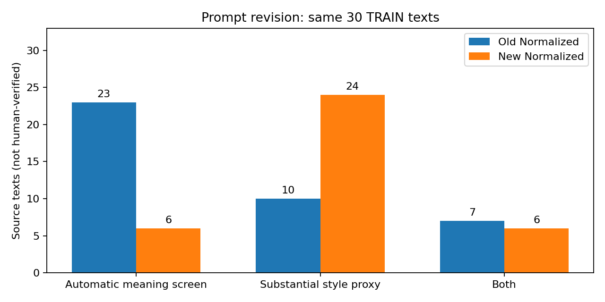

# שכתוב מחדש של 30 טקסטי אימון — prompt חדש

## מה בוצע

ה־prompt שסיפקה המשתמשת הועבר ללא תווית/שם כותב/ציונים, עם Original בלבד כקלט. נוצר מועמד יחיד לכל מקור. אותו Qwen2.5-3B-Instruct Q4_K_M קפוא, seed 20261026, temperature=0 ותקציב פלט 320 כמו ב־V2. לא הועברו למודל שכתובים קודמים או דירוגי External LLM Review. לא נבחר המועמד לפי תחזית מסווג, לא שונו ספים ולא בוצע אימון.

## תוצאות אוטומטיות בלבד

| גרסה | עברו כל מסנני השימור | שינוי style משמעותי לפי proxy | שניהם יחד | העתקים מדויקים |
| --- | --- | --- | --- | --- |
| Old | 23 | 10 | 7 | 7 |
| New | 6 | 24 | 6 | 0 |

מעבר במסננים אינו הוכחה לשימור meaning/stance/framing. דגל substantial הוא כלל המדידה הקיים, לא הכרעה ששינוי הסגנון אמיתי. אימות אנושי ובדיקת LLM חיצונית של הגרסה החדשה לא בוצעו.

## היכן הוסרו/נוספו דגלי כשל

כשל סינון קודם נפתר אוטומטית ב־1 דוגמאות: creators:120669.
שינוי סגנוני חלש הפך לשינוי משמעותי לפי proxy שעבר סינון ב־3 דוגמאות: creators:419062, creators:423315, creators:224770.
נוצר כשל אוטומטי לאחר מעבר קודם ב־18 דוגמאות: creators:0105f26ef9f1, creators:422329, creators:212505, creators:422331, creators:216128, creators:421279, creators:295188, creators:422146, creators:421853, creators:418620, creators:114783, creators:8b0d99b23d03, creators:97c9d6b9ac1b, creators:423545, creators:298495, creators:418904, creators:116358, creators:418827.
זיהוי הסיכון נעשה מהבדיקות בלבד. אין לייחס שינוי certainty/attribution או semantic drift מאומת רק לפי דגל אוטומטי. ניתן לעיין במקור ובשכתובים בטבלת ההשוואה.

| ID | דגלים שנעלמו | דגלים שנוספו | עבר קודם | עבר חדש |
| --- | --- | --- | --- | --- |
| creators:0105f26ef9f1 |  | certainty\|future_tense | True | False |
| creators:421024 |  |  | True | True |
| creators:422329 |  | bidirectional_nli | True | False |
| creators:417181 | bidirectional_nli | entities | False | False |
| creators:120177 |  |  | False | False |
| creators:212505 |  | numbers | True | False |
| creators:421951 |  |  | True | True |
| creators:422331 |  | bidirectional_nli | True | False |
| creators:120669 | bidirectional_nli |  | False | True |
| creators:216128 |  | entities | True | False |
| creators:421279 |  | bidirectional_nli\|certainty | True | False |
| creators:419062 |  |  | True | True |
| creators:295188 |  | bidirectional_nli | True | False |
| creators:423315 |  |  | True | True |
| creators:422146 |  | bidirectional_nli\|negation | True | False |
| creators:421853 |  | negation | True | False |
| creators:418620 |  | future_tense | True | False |
| creators:114783 |  | attribution\|negation\|numbers\|quotations | True | False |
| creators:224770 |  |  | True | True |
| creators:8b0d99b23d03 |  | bidirectional_nli\|quotations | True | False |
| creators:97c9d6b9ac1b |  | bidirectional_nli\|certainty | True | False |
| creators:423545 |  | bidirectional_nli\|certainty\|quotations | True | False |
| creators:298495 |  | attribution\|negation | True | False |
| creators:418904 |  | bidirectional_nli\|quotations | True | False |
| creators:2e34435c6ccf | framing_anchors | certainty\|negation\|similarity | False | False |
| creators:459e183c1d0d | bidirectional_nli |  | False | False |
| creators:416436 |  |  | False | False |
| creators:116358 |  | numbers | True | False |
| creators:218236 |  |  | False | False |
| creators:418827 |  | bidirectional_nli\|framing_anchors | True | False |

## סיבות פסילה בגרסה החדשה

| דגל | מספר |
| --- | --- |
| certainty | 9 |
| future_tense | 2 |
| bidirectional_nli | 10 |
| entities | 2 |
| quotations | 6 |
| numbers | 3 |
| negation | 5 |
| attribution | 2 |
| similarity | 1 |
| framing_anchors | 1 |
סיבות חופפות. המודלים והספים לא שונו: MPNet cosine≥0.85, DeBERTa entailment≥0.6 בשני הכיוונים, NER ושמירת מספרים/שלילה/ודאות/ייחוס/מסגור/ציטוטים, זמן עתיד, אורך ואי־קטיעה.
נוסף דיאגנוסטיקת ציטוטים verbatim ובאותו סדר, בלי לשנות את החלטת המסנן הקיים. פירוט ב־comparison_30.csv.

## מה ניתן להסיק

זהו סבב פיתוח על 30 דוגמאות אימון שנבחרו במכוון ושכבר נבדקו בעבר. אפשר להשוות עוצמת שינוי ודגלי סיכון אוטומטיים באותם מקורות. אין כאן אומדן הכללה, Author Identification, Macro-F1 או בדיקה על test. התוצאות אינן מאפשרות להכריז על הסרת shortcut או causality. אין להעביר אישורי LLM ישנים לשכתובים החדשים.

## תוצרים ושחזור

- COMPARISON_30_HE.md ו־comparison_30.csv: כל שלוש הגרסאות לכל ID.
- rewrite_validation.csv: כל תוצאות הבדיקות בגרסה החדשה.
- style_metrics_old_new.csv ו־explicit_style_changes_old_new.csv: אותם מדדי V2 ו־66 מאפיינים מפורשים.
- prompt.txt, protocol.json, generator_manifest.json ו־audit_trail.jsonl: מקור ההוראות, גרסאות, seed, ספים וזמנים.
- integrity_audit.json: אימות שמקור, תוויות, splits, תוצרי עבר וקוד האימון לא השתנו.
- להפעלה: python artifacts/experiments/style_intervention_v2_20261026/train_prompt_revision_30_20261101/run.py --stage all
- נדרשת סביבת Python הקיימת, מודלים ב־cache וה־runtime של הניסוי הקודם. הריצה מסתיימת בדוח, ללא אימון.

## דוגמאות ממוקדות להשוואה ולבדיקה חיצונית

הדוגמאות להלן מציגות טקסט ודגלים בלבד, ללא הכרעת שימור חדשה. ב־creators:212505 מופיע 10 במקור ו־ten בחדש, ולכן כלל המספרים הלקסיקלי פוסל; אין להסיק מפסילה כזו לבדה שינוי בכמות. ב־creators:421279 הוחלף may ב־might. ב־creators:97c9d6b9ac1b מופיע bulldozers בפלט החדש; ב־creators:298495 הביטוי strangers מוחלף ב־anonymous sources; וב־creators:114783 הציטוט המקורי אינו נשמר כלשונו. יש לבחון את ההשלכות הסמנטיות בבדיקה חיצונית נפרדת, ולא לאשר/לפסול משמעות כאן על סמך קריאת עוזר נוספת.

| ID | Original | Old Normalized | New Normalized | דגלים חדשים |
| --- | --- | --- | --- | --- |
| creators:120669 | Last week, when "Fox & Friends" highlighted my most recent column, titled "Neutering Religious Holidays," liberals came out of the woodwork to try to defend President Barack Obama's record. So I decided to do a little research and see just how spiritual his past Thanksgiving addresses have been and compare them with the thoughts of our founding president, George Washington. | Last week, when "Fox & Friends" highlighted my most recent column titled "Neutering Religious Holidays," liberals sprang into action to defend President Barack Obama's record. So I decided to conduct some research and examine how spiritually President Washington's Thanksgiving addresses were, and compare them to the thoughts of our founding father, George Washington. | Last week, when "Fox & Friends" featured my latest column, "Neutering Religious Holidays," liberals sprang into action to defend President Barack Obama's record. So I decided to conduct some research and examine how spiritually his past Thanksgiving addresses have been, and compare them with the sentiments of our founding father, George Washington. |  |
| creators:419062 | From Q-Anon nuttiness to JD Vance's "Deep State" quackery, wacko right-wing conspiracies have oozed into the center of Republican politics. But don't let their goofiness obscure the fact that there is indeed a very real plot to rig America's economic and political system, causing wealth and power to flow uphill — from the workaday majority to moneyed elites. | From Q-Anon nuttiness to JD Vance's "Deep State" quackery, wacko right-wing conspiracies have infiltrated the center of Republican politics. But don't let their goofiness obscure the fact that there is indeed a very real plot to rig America's economic and political system, causing wealth and power to flow uphill — from the workaday majority to moneyed elites. | From Q-Anon's far-out theories to JD Vance's "Deep State" nonsense, fringe right-wing conspiracies have crept into the heart of Republican politics. But don't let their absurdity distract from the reality that there is a serious plot to manipulate America's economic and political landscape, funneling wealth and power upwards — from the everyday majority to the moneyed elite. |  |
| creators:212505 | Financial markets and most media pundits are missing the new writing on the wall. For a variety of reasons surrounding shrewd moves by President Trump, the chances for significant tax cuts in the next 10 weeks have risen sharply. | Financial markets and most media pundits are overlooking the new developments. Various reasons, including shrewd moves by President Trump, have increased the likelihood of significant tax cuts in the next 10 weeks. | Financial markets and many media analysts are overlooking the emerging trends. Various factors, including President Trump's strategic maneuvers, have increased the likelihood of substantial tax cuts within the next ten weeks. | numbers |
| creators:421279 | You may wonder why President Donald Trump is doing everything he can, day by day, to destroy faith in democracy in little and large ways, on the job day and night. I have an answer that will presently be revealed. | You may wonder why President Donald Trump is doing everything he can, day by day, to destroy faith in democracy in little and large ways, on the job day and night. I have an answer that will presently be revealed. | You might ponder why President Donald Trump is doing everything in his power, day in and day out, to undermine trust in democracy, both big and small. I have an explanation that will soon be made public. | certainty\|bidirectional_nli |
| creators:97c9d6b9ac1b | WASHINGTON — Something told me to get me over to East Potomac Park before Donald Trump destroyed it. Sure enough, I did, on a rainy Sunday morning, for a rally to protect the waterfront parkland from his axe. On the next weekend, he cut down 430 trees — for a fancy golf course, of course. He sneakily started on a Saturday morning on the three-day holiday weekend. | WASHINGTON — Something told me to get to East Potomac Park before Donald Trump destroyed it. Sure enough, I did on a rainy Sunday morning for a rally to protect the waterfront parkland from his axe. On the next weekend, he cut down 430 trees — for a fancy golf course, of course. He sneakily started on a Saturday morning during the three-day holiday weekend. | WASHINGTON — Something prompted me to visit East Potomac Park before Donald Trump could dismantle it. Indeed, I did so on a dreary Sunday morning, to rally against the erosion of waterfront parkland by his bulldozers. The following weekend, he felled 430 trees — for a golf course, of course. He began on a Saturday morning during the three-day holiday weekend, covertly. | certainty\|bidirectional_nli |
| creators:298495 | After I first started writing a column, in the fall of 2002, it wasn't long before I heard regularly from those who brandished God as a weapon in opposing LGBTQ rights. This was not surprising. Back then, I was on staff at The Plain Dealer in Cleveland, and I was long familiar with the bigotry in my home state. Most of the hate mail came from strangers, but I got my share of lectures from blood relatives, too. Few things anger right-wing Christians more than a family member insisting she's acquainted with a different version of God. | After I first started writing a column in the fall of 2002, it wasn't long before I heard regularly from those who brandished God as a weapon in opposing LGBTQ rights. This was not surprising. Back then, I was on staff at The Plain Dealer in Cleveland, and I was long familiar with the bigotry in my home state. Most of the hate mail came from strangers, but I got my share of lectures from blood relatives, too. Few things anger right-wing Christians more than a family member insisting she's acquainted with a different version of God. | After I began writing a column in the fall of 2002, it wasn't long before I received regular correspondence from individuals who used God as a tool to oppose LGBTQ rights. This was unsurprising. At the time, I was employed at The Plain Dealer in Cleveland, and I was already well-acquainted with the bigotry in my home state. Most of the hate mail came from anonymous sources, but I also received lectures from family members. Few things infuriate right-wing Christians more than a family member who claims to know a different version of God. | negation\|attribution |
| creators:114783 | We said on 9/11 that we'd "never forget." But when our president has a no-strategy strategy for stopping Islamic extremists, isn't Washington sidestepping our commitment of remembrance, in addition to its duty to protect our land and liberties? | We said on 9/11 that we'd "never forget." But when our president has a no-strategy strategy for stopping Islamic extremists, isn't Washington sidestepping its commitment of remembrance, in addition to its duty to protect our land and liberties? | We declared on September 11 that we would never forget the horrors of that day. Yet, when our president opts for a strategy that lacks any clear plan to combat Islamic extremists, doesn't Washington seem to be avoiding its pledge of remembrance, as well as its obligation to safeguard our nation and freedoms? | numbers\|negation\|attribution\|quotations |

## New Normalized — External LLM Review 2026-11-01

יובא קובץ הבדיקה החיצונית של כל 30 ה־New Normalized, בהתאמת ID מלאה למדגם train בלבד. ההכרעות להלן הן דירוגי LLM שסופקו, לא שיפוט חדש של סוכן הייבוא ולא אימות אנושי. גרסת המודל, prompt ההערכה ומועד ההערכה המדויק לא סופקו. הקובץ אינו מכיל hash או טקסט שנסקר; שיוך הגרסאות נשען על ה־IDs והקשר המסירה. אין לטעון לבדיקה עיוורת או לעצמאות בין הסבבים.

**שם הבדיקה: External LLM Review — New Normalized.** היא נשמרת בנפרד מ־Human Validation ומבדיקת ה־Old Normalized הקודמת.

| שדה חיצוני | Yes | Borderline | No |
| --- | --- | --- | --- |
| meaning_preserved | 10 | 15 | 5 |
| stance_preserved | 29 | 1 | 0 |
| attribution_preserved | 29 | 0 | 1 |
| certainty_preserved | 28 | 2 | 0 |
| style_change_valid | 30 | 0 | 0 |
| semantic_drift | 20 | 0 | 10 |

Meaning Preserved: **10/30 Yes, ‏15/30 Borderline, ‏5/30 No**. שינוי style אמיתי לפי ה־External LLM Review: **30/30**; זהו דירוג הבודק החיצוני ולא אימות אנושי.

### סיווג פערים ביחס ל־LLM

"Positive" פירושו איתות לסיכון בשימור משמעות. True/False מתארים התאמה ל־LLM בלבד, לא אמת מחקרית מאומתת. פסילה אוטומטית ו־semantic_drift=Yes מסווגת True Positive; פסילה עם meaning=Yes ו־drift=No היא False Positive; מעבר עם אותו אישור הוא True Negative; מעבר עם drift=Yes או Borderline משמעותי הוא False Negative. כל 15 מקרי ה־Borderline בקובץ מסומנים גם semantic_drift=Yes במקור, ולכן הסיווג נשען על דגל מפורש, בלי להמיר meaning=Borderline ל־No. שדה המשמעות המקורי נשמר, וכן קובץ Borderline נפרד ופירוט בכל קטגוריה.

| סיווג ביחס ל־LLM | סה״כ | Meaning Yes | Meaning Borderline | Meaning No |
| --- | --- | --- | --- | --- |
| True Positive | 19 | 0 | 14 | 5 |
| False Positive | 5 | 5 | 0 | 0 |
| True Negative | 5 | 5 | 0 | 0 |
| False Negative | 1 | 0 | 1 | 0 |

פסילות שנראו מוצדקות לפי ה־LLM (True Positive): creators:422329, creators:417181, creators:422331, creators:216128, creators:421279, creators:295188, creators:422146, creators:421853, creators:114783, creators:8b0d99b23d03, creators:97c9d6b9ac1b, creators:423545, creators:298495, creators:418904, creators:2e34435c6ccf, creators:416436, creators:116358, creators:218236, creators:418827.

פסילות שנראו False Positives לפי ה־LLM: creators:0105f26ef9f1, creators:120177, creators:212505, creators:418620, creators:459e183c1d0d.

עברו אוטומטית אך קיבלו Borderline/No: creators:423315 — במקרה זה Borderline, ואין מקרה שעבר וקיבל No.

דוגמאות הכשל המרכזיות לפי הבודק: `417181` — semantic drift והתחזקות certainty, לצד שינוי ייחוס; `8b0d99b23d03` — שינוי הציטוט המיוחס ל־F. Scott Fitzgerald ושינוי מטאפורת “two countries”; `423545` — החלשת stance/המסגור באמצעות הסרת “right-wing hack” והחלשת המטאפורה (למרות שדה stance_preserved=Yes, שנשמר כמות שהוא); `298495` — שינוי עובדתי מ־strangers ל־anonymous sources; `418904` — שינוי ציטוט ישיר. אלו פירושים לתוצאות ה־LLM שסופקו, ולא הכרעות אנושיות חדשות או אימות פרטני של כל guard.

שימור מחמיר לצורך סיכום בלבד (meaning, stance, attribution, certainty כולם Yes וגם semantic_drift=No): **10/30**; שימור מחמיר ושינוי style=Yes יחד: **10/30**. זהו חיתוך תיאורי של שדות חיצוניים, לא שינוי סף קבלה או מסנן.

מבין הפסילות האוטומטיות, 5 דורגו כשימור מחמיר — מועמדים ל־false positives ביחס לבודק החיצוני, לא הוכחת תקינות. מבין המעברים האוטומטיים, 1 קיבלו meaning שאינו Yes. אין להמיר אי־הסכמה עם LLM ל־false positive/negative מאומת. Borderline נשמר בנפרד ואינו נספר כהצלחה; semantic_drift=Yes הוא קביעת ה־LLM בלבד.

`creators:120669`: הבודק מציין שהטעות Obama/Washington הקודמת תוקנה. `212505`: הבודק רואה ב־10→ten שינוי עיצוב בלבד ומאשר שימור. `419062` ו־`224770` מאושרים לשימור ולסגנון; לעומתם `423315`, שעבר בסינון, דורג Borderline בגלל riots→protests ו־going to lose→destined to lose. `421951` עבר אוטומטית ואושר חיצונית; זו עדיין אינה אמת אנושית. `298495` דורג No במשמעות בגלל strangers→anonymous sources, אף ששדה attribution דורג Yes; ההבדל בין השדות נשמר. `114783` דורג Borderline עם פגיעה בנאמנות לציטוט. אין להסיק מכך שדגלי negation/attribution שלו אומתו פרטנית.

ה־LLM דירג שינוי style כ־Yes בכל 30 המקרים. לעומת זאת ה־proxy האוטומטי סימן 24/30. בבדיקה החיצונית הקודמת של Old Normalized היו meaning=Yes ב־27/30 ו־style=Yes ב־9/30; אין זו השוואה מבוקרת בין מעריכים, ואין לערבב ספירות חיצוניות עם 23→6 ו־10→24 האוטומטיות. התמונה התיאורית היא שינוי סגנוני רחב יותר לצד יותר הסתייגויות משימור משמעות.

לא שונו prompt, guards, ספים, טקסטים, תוויות, split, test או שדות human review; לא הורצו מודל שופט, שכתוב נוסף או אימון. הבדיקה אינה פותחת את שער האימות האנושי לאימון. עוצרים לדיון בתוצאות לפני כל ניסוי או כוונון נוסף.

**ה־prompt החדש מצליח לייצר שינוי סגנוני משמעותי, אבל מגדיל את הסיכון ל־semantic drift. הבדיקות האוטומטיות מזהות חלק מהכשלים, אך יש גם false positives וגם מקרים שהן אינן מספיקות לבדן.** זו מסקנת הפיתוח הנוכחית על המדגם המכוון ובהסתמך על דירוגי ה־External LLM Review, לא אומדן על test.

[הדוח המלא וכל 30 ההכרעות](external_llm_review_20261101/REPORT_HE.md)
