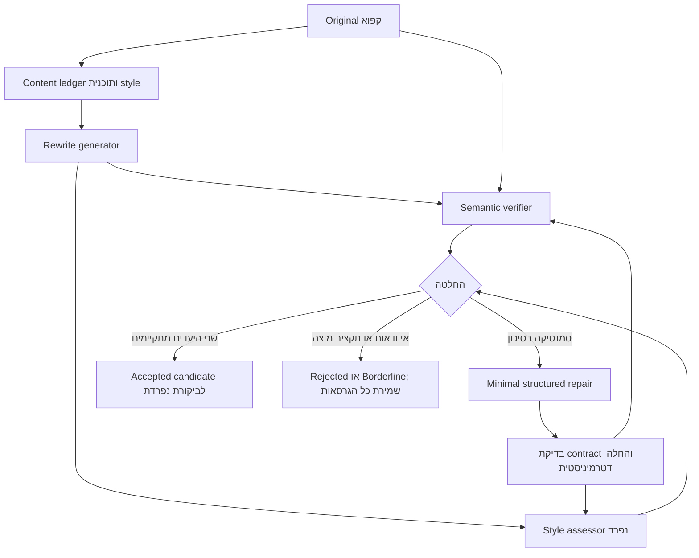

# Design מוצע — Semantic-preserving style intervention

2026-11-02. **הצעה בלבד; לא מומשה ולא נוסתה.** בסיס ספרותי והבחנות משימתיות: [Related Work](style_transfer_related_work_he.md). ההמלצה היא **D: שילוב A+B+C מוגבל**, ללא reward-based training.

## הבעיה והיעד

חוזה patches תקין פותר בעיות ביצוע, אך אינו מבטיח שה־verifier ימצא את הפגם או שה־repairer יבחר החלפה נכונה. ב־debug המקומי עברו 6/6 חוזי verification והוחלו 5/9 patches; נשארו החמצות ואף נוצר ציטוט פגום. לכן היעד הבא, אם יאושר, הוא בדיקת יכולת semantic verification בנפרד מיכולת ההחלה, לפני הרחבת ניסוי ההתערבות.

Style הוא משתנה התערבות; narrative/stance הם invariants. לא מקבלים ניסוח חדש רק מפני שהוא שונה מאוד, ולא משנים עובדות כדי לשפר ציון. כל ההגדרות להלן הן אפשרויות design עתידיות, לא שינויים בפרוטוקול, ב־prompts, ב־guards או בספים הנוכחיים.

## רכיבים וזרימת מידע

| רכיב | אחריות וקלט/פלט מוצעים |
|---|---|
| Content ledger + planner | מפיק מה־Original טענות וראיות: מי עשה מה למי, זמן, כמות, negation, certainty, attribution, ציטוט ו־event framing. במקביל בוחר רק צירי style מותרים. ה־ledger אינו תחליף למקור: כל בדיקה רואה גם Original. אין תווית נרטיב או scores של classifier בבקשת rewrite. |
| Generator | יוצר מועמד אחד לפי תוכנית style קבועה, מה־Original ומה־invariants. לא משתמש ב־Old Normalized כבסיס ולא מתקן עובדות מבחוץ. אין שינוי generator בפועל במסגרת מסמך זה. |
| Semantic verifier | תפקיד נפרד מה־generator, עם Original, candidate ו־ledger; ללא rationale של ה־generator או ציוני style. מחזיר preserved / borderline / violated וראיות ממוספרות לכל fault. מודל או prompt נפרד אינם כשלעצמם עצמאות מחקרית; בחירת verifier תדרוש בדיקת recall ודיוק נפרדת על development. |
| Style assessor | בודק את הצירים שנקבעו באמצעות מדדי style נפרדים, ללא ציון narrative classifier. בהמשך אפשר לבדוק author signal בניתוח נפרד. אין להסיק שנוטרל author style מציון lexical-edit גבוה בלבד. |
| Repairer + executor | רק faults הנתמכים בראיות; הצעות קטנות בחוזה structured patch, כולל כיוון Original evidence → current Rewrite target. executor בודק יעד יחיד, offsets, גודל ותאימות operation. אין החלפת פסקה אוטומטית. |
| Controller | שומר candidate, parent hash, feedback, patches ותוצאת הבדיקה אחרי כל צעד. אינו מעניק לפלט status של human validation. |

## קבלה, תיקון ועצירה

**שני יעדים נפרדים:** semantic status ו־style status. קבלה מוצעת רק כאשר אין פגם או Borderline לא פתור, ויעד style מתוכנן מתקיים. guards נשארים signals ולא הוכחת equivalence. מחלוקת בין guard ל־verifier מועברת לביקורת נפרדת; לא מסווגת אוטומטית כ־false positive.

אין ממוצע style/semantics שבו style גבוה מפצה על שינוי משתתף, ציטוט או certainty. נוסח משוכפל שלא משתנה יכול להיות fallback בטוח, אבל אינו הצלחה סגנונית. “Accepted” בתהליך זה פירושו מועמד שעבר את מדיניות הפיתוח; עדיין לא gold אנושי.

כשמזוהה drift, מוצע תיקון מקומי אחד לכל issue, ואחריו בדיקה חוזרת **מול Original**, לא רק מול הגרסה הקודמת. בדיקת style חוזרת משום שתיקון תוכן עשוי לבטל שינוי סגנוני. גבולות ציטוט מלאים נבדקים גם כאשר ה־patch עצמו קצר: ה־debug הראה שהחלפת prefix חוקית יכולה להשאיר suffix שגוי. זהו requirement מוצע, לא guard חדש שהוטמע.

**תקציב מוצע, שטרם אושר/כוונן:** לכל היותר שני סבבי repair; עצירה מוקדמת כשאין שינוי, כש־candidate hash חוזר, כשיש fault חדש או כשאין ירידה במספר faults נתמכים. כשל schema מקבל לכל היותר retry טכני אחד נפרד מתקציב האיכות. במיצוי התקציב מסמנים unresolved/rejected ושומרים את המועמדים; לא מחזירים אוטומטית את האחרון כהצלחה. ספים ותקציבים צריכים להיקבע מראש על development בלבד לפני מימוש.

## מקור הרעיונות וההתאמות

| מנגנון | ייחוס מדויק | מה שוקלים אצלנו |
|---|---|---|
| פירוק תתי־משימות ובדיקת קונפליקטים | [Zhang et al., 2025, §4](https://aclanthology.org/2025.findings-emnlp.1166.pdf) | תוכנית מצומצמת, verifier ותיקון מוגבל; לא טענה שהמאמר מציע exact patches או verifier עצמאי. |
| שתי מטרות מדידה | [Lai et al., 2021, §2.2–3](https://aclanthology.org/2021.acl-short.62.pdf) | semantic/style scoring מופרד בזמן inference; זו התאמה שלנו, ללא policy-gradient או BLEU reward training. |
| שליטה בצירי סגנון כותב | [Fisher et al., 2024](https://aclanthology.org/2024.emnlp-main.241/) | רשימת צירים מפורשת והבחנה בין style change ל־author signal; לא אימון/הפעלת LoRA כעת. |
| ראיות בצד הנכון, exact patches ו־audit trail | מימוש הפיתוח המקומי שלנו | תשתית ביצוע הנבחנת טכנית; לא נטענת כחדשנות מדעית מוכחת. |
| Narrative invariants, הפרדת כותבים וביקורת עצמאית | דרישות מחקר Narrative Lens | ניסוי shortcut/generalization עתידי, רק לאחר תיקוף ההתערבות; לא אופטימיזציה מול תוצאות test. |

המסמך אינו מציע לעבור מיד למערכת רבת־סוכנים גדולה. לפני כל ניסוי נוסף יש להחליט על יכולת ה־verifier, חוזה feedback וקריטריוני קבלה; אחר כך ניתן לאשר implementation ופרוטוקול development חדש. לא בוצעו כאן training, LoRA, External LLM Review או test evaluation.
